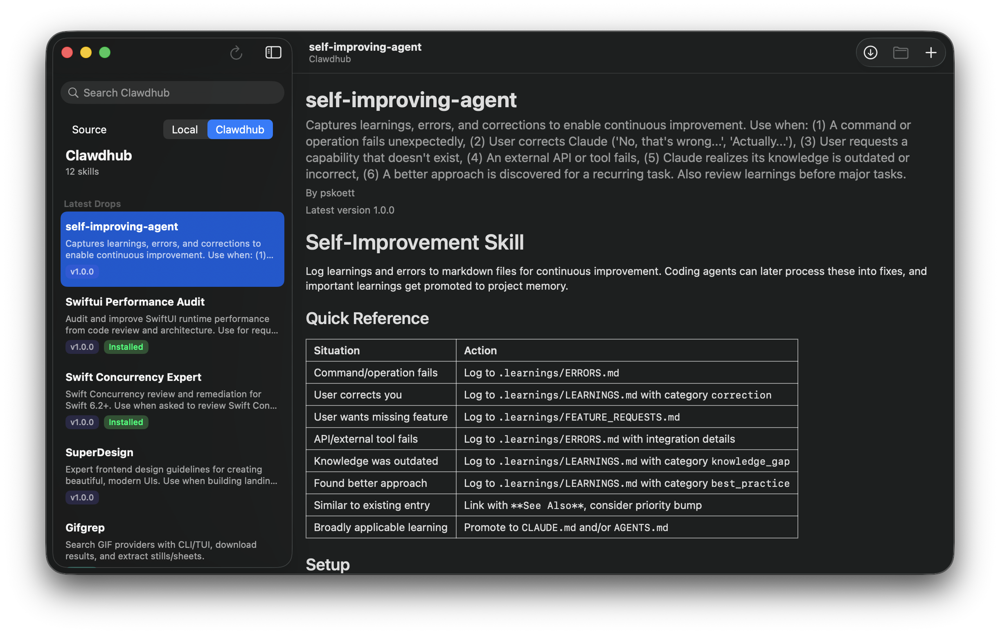

# Codex Skill Manager



Codex Skill Manager is a macOS SwiftUI app built with SwiftPM (no Xcode project). It manages local skills for Codex and Claude Code, renders each `SKILL.md`, and lets you browse remote skills from Clawdhub.

## Features
- Browse local skills from `~/.codex/skills`, `~/.codex/skills/public`, and `~/.claude/skills`
- Render `SKILL.md` with Markdown, plus inline reference previews
- Import skills from a folder or zip
- Delete skills from the sidebar
- Browse Clawdhub skills with search + latest drops
- Download remote skills into Codex and/or Claude Code
- Show Clawdhub author info in the detail view
- Visual tags for installed status (Codex/Claude) and versions

## Requirements
- macOS 26+
- Swift 6.2+

## Build and run
```
swift build
swift run CodexSkillManager
```

## Package a local app
```
./Scripts/compile_and_run.sh
```

## Credits
- Markdown rendering via https://github.com/gonzalezreal/swift-markdown-ui
- Remote skill catalog via https://clawdhub.com


## Security: Passwords

CodexSkillManager uses **Argon2id** (winner of the Password Hashing Competition).

### Benchmark (10ms target on server hardware)
| Algorithm | Work Factor | Memory | Security |
|-----------|------------|--------|----------|
| Argon2id | m=64MB, t=3, p=1 | 64MB | 🏆 Best |
| bcrypt | cost=12 | ~4KB | Good |
| PBKDF2 | iterations=210000 | Low | OK |
| MD5/SHA | — | Minimal | ❌ Never |

### Configure
```yaml
repo:
  security:
    password:
      algorithm: argon2id
      memory-cost: 65536
      time-cost: 3
      parallelism: 1
```

### Verify a hash
```bash
htpasswd -BnBC 12 '' < password.txt
```


## Environments

CodexSkillManager operates three environments.

| Env | Purpose | Deploy | Data | URL |
|-----|---------|--------|------|-----|
| **dev** | Day-to-day dev | On every push | Fresh seed data | dev.CodexSkillManager.example.com |
| **staging** | Pre-prod verification | On merge to main | Production copy (anonymized) | staging.CodexSkillManager.example.com |
| **production** | Live service | On tagged release | Real | CodexSkillManager.example.com |

### Promotion Flow
`dev → staging` (auto on merge) → manual approval → `production` (on tag)

### Secrets Management
All secrets in environment variables — never hardcoded. Rotate quarterly via Vault.
